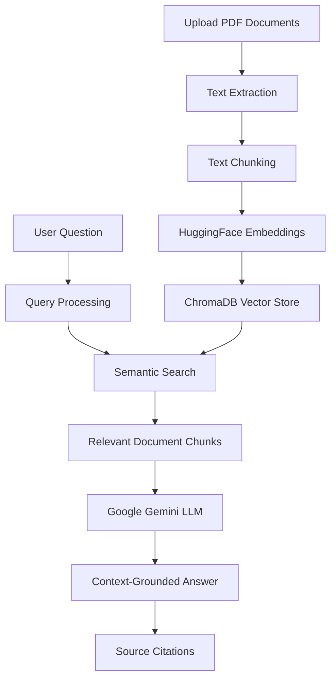

# 📚 PDF RAG Assistant

An AI-powered document assistant that allows users to upload one or multiple PDF documents and ask questions based on their content. Built using **Retrieval-Augmented Generation (RAG)**, the system retrieves relevant information from documents and generates context-aware answers with source citations.

## 🚀 Features

- 📄 Upload one or multiple PDF documents
- ✂️ Automatic text extraction and chunking
- 🧠 Embedding generation for document understanding
- 🔍 Semantic search using a vector database
- 🤖 Context-grounded answers using Google Gemini
- 📑 Source citations with document name and page number
- 💬 Interactive chat interface built with Streamlit
- 🔗 FastAPI backend for API-based document processing and question answering

## 🛠️ Tech Stack

| Technology | Purpose |
|---|---|
| Python | Core programming language |
| Streamlit | Frontend and interactive chat UI |
| FastAPI | Backend REST API |
| Google Gemini | LLM-based answer generation |
| LangChain | RAG pipeline and AI integration |
| HuggingFace Sentence Transformers | Text embedding generation |
| ChromaDB | Vector storage and semantic retrieval |

## 🏗️ Architecture



## ⚙️ Installation & Setup

### 1. Clone the Repository

```bash
git clone https://github.com/your-username/pdf-rag-assistant.git
cd pdf-rag-assistant
```

### 2. Install Dependencies

```bash
pip install -r requirements.txt
```

### 3. Configure Environment Variables

Create a `.env` file in the project root directory and add your Google Gemini API key:

```env
GOOGLE_API_KEY=your_google_api_key_here
```

Get your API key from [Google AI Studio](https://aistudio.google.com/).

> Never commit your `.env` file or expose your API key publicly.

### 4. Start the Backend

Open a terminal and run:

```bash
cd backend
uvicorn app:app --reload --port 8000
```

Backend API will be available at:

- API: http://127.0.0.1:8000
- API Documentation: http://127.0.0.1:8000/docs

### 5. Start the Frontend

Open a second terminal and run:

```bash
cd frontend
streamlit run main.py
```

The Streamlit interface will open in your browser.

## 📖 How It Works

1. **Upload Documents** – Upload one or multiple PDFs through the interface.
2. **Text Extraction** – Extract text and metadata from the uploaded documents.
3. **Chunking** – Split document text into smaller chunks for efficient retrieval.
4. **Embedding Generation** – Convert document chunks into vector embeddings using HuggingFace Sentence Transformers.
5. **Vector Storage** – Store embeddings in ChromaDB for similarity-based search.
6. **Question Processing** – Process the user's question and search for semantically relevant content.
7. **Context Retrieval** – Retrieve relevant chunks from the uploaded documents.
8. **Answer Generation** – Pass the retrieved context to Google Gemini to generate a grounded response.
9. **Source Attribution** – Provide document names and page references to help users verify answers.

## 📸 Application Workflow

```text
Upload PDF(s)
     │
     ▼
Extract Document Text
     │
     ▼
Split into Text Chunks
     │
     ▼
Generate Embeddings
     │
     ▼
Store in ChromaDB
     │
     ▼
Ask Questions
     │
     ▼
Retrieve Relevant Context
     │
     ▼
Generate Answer with Gemini
     │
     ▼
Display Answer + Sources
```

## 🎯 Use Cases

- Research paper analysis
- Academic notes and study materials
- Technical documentation search
- Reports and business documents
- Manuals and reference guides
- Multi-document knowledge retrieval

## 🔮 Future Improvements

- Chat history and conversational memory
- Advanced hybrid search (keyword + semantic)
- Retrieval reranking
- Document-level relevance scoring
- User authentication and document management
- Cloud deployment and scalability
- Enhanced source highlighting and citations

## 👨‍💻 Author

**Gursimar Singh**

AI/ML | Generative AI | Software Development

Interested in building intelligent applications using AI, Machine Learning, Generative AI, backend engineering, and scalable software systems.

## 📜 License

This project is open source and available for educational and learning purposes.

---

⭐ If you find this project useful, consider giving it a star.